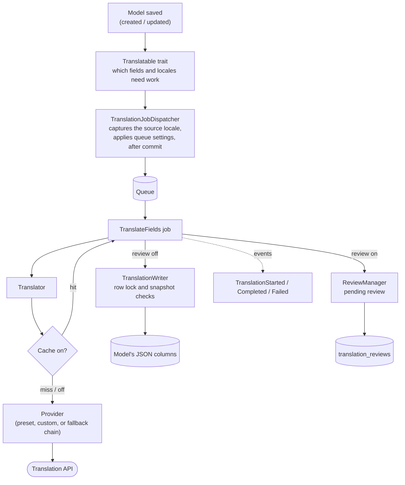

# TranslaGenius

[](https://packagist.org/packages/coding-partners/transla-genius)
[](https://packagist.org/packages/coding-partners/transla-genius)
[](https://github.com/YousefSaleh1/transla-genius/actions/workflows/tests.yml)
[](composer.json)
[](composer.json)
[](LICENSE)

TranslaGenius translates the translatable attributes of your Eloquent models automatically. When a record is saved, a queued job sends each missing field and language to an AI translation provider and stores the results with [spatie/laravel-translatable](https://github.com/spatie/laravel-translatable).

It works with any API that speaks the OpenAI chat-completions format. Presets for OpenRouter, OpenAI, Gemini, DeepSeek and Mistral are included, and you can plug in any other API, such as DeepL, with one class.

## Highlights

- **Automatic and queued.** Creating a record fills every missing language. Editing the source text re-translates the other languages. Jobs dispatch after the database transaction commits.
- **Provider choice from `.env`.** Switch presets, or chain several for failover, without touching code or config.
- **Fills only what is missing.** Each field/language pair is saved as soon as it is translated, so a retried job never pays twice for work that already succeeded.
- **Safe with concurrent edits.** Writes happen under a row lock and check snapshots, so a stale job never overwrites a newer edit or a hand-corrected translation.
- **Optional extras, all off by default:** per-field batching, a translation cache, usage and cost tracking, and a human review workflow.
- **Hooks for your own code:** lifecycle events, a custom provider interface, custom job classes and a swappable locale resolver.

## Table of contents

- [Requirements](#requirements)
- [Installation](#installation)
- [Quick start](#quick-start)
- [How it works](#how-it-works)
- [Configuration](#configuration)
  - [Providers and presets](#providers-and-presets)
  - [Switching providers](#switching-providers)
  - [Fallback chains](#fallback-chains)
  - [Any other OpenAI-compatible endpoint](#any-other-openai-compatible-endpoint)
  - [Source language](#source-language)
  - [Queue](#queue)
  - [System prompt](#system-prompt)
  - [Reasoning effort and extra request fields](#reasoning-effort-and-extra-request-fields)
  - [Output limit and temperature](#output-limit-and-temperature)
  - [Retries and rate limits](#retries-and-rate-limits)
- [Features in depth](#features-in-depth)
  - [Batching](#batching)
  - [Translation cache](#translation-cache)
  - [Usage and cost tracking](#usage-and-cost-tracking)
  - [Review workflow](#review-workflow)
  - [Events](#events)
  - [Query scopes](#query-scopes)
  - [Translating arbitrary text](#translating-arbitrary-text)
- [Artisan commands](#artisan-commands)
- [Extending](#extending)
  - [A custom provider (DeepL)](#a-custom-provider-deepl)
  - [Custom jobs](#custom-jobs)
  - [Locale resolver](#locale-resolver)
- [Environment variable reference](#environment-variable-reference)
- [Testing](#testing)
- [Troubleshooting and FAQ](#troubleshooting-and-faq)
- [Upgrading](#upgrading)
- [Changelog](#changelog)
- [Contributing](#contributing)
- [Security](#security)
- [License](#license)
- [Credits](#credits)

## Requirements

- PHP 8.3 or later
- Laravel 12 or 13
- A queue worker (or the `sync` queue for local development)
- An API key for one of the supported providers

| Database | Minimum version | Tested in CI |
|---|---|---|
| MySQL | 5.7 | 8.0 |
| MariaDB | 10.3 | 10.6 |
| PostgreSQL | 10 | 16 |
| SQL Server | 2017 | 2022 |
| SQLite | 3.38, or 3.26 built with JSON1 | the PHP build's bundled version |

The minimums are Laravel's own, except SQLite: the package's scopes need SQLite's JSON functions, which are built in only from 3.38. Run `php artisan translagenius:check` to confirm your connection supports what the package needs.

<details>
<summary>Database notes</summary>

- **SQLite.** Before 3.38, JSON functions were an optional extension, and some PHP builds (older Debian and Ubuntu images, some Windows builds) shipped without them. Without them, the first save fails with `no such function: json_extract`. `translagenius:check` detects this. `lockForUpdate()` compiles to nothing on SQLite; writes are still safe because SQLite serializes all writers at the file level.
- **MySQL and MariaDB.** The row lock that protects concurrent writes needs the InnoDB engine. On a MyISAM table the lock does nothing.
- **PostgreSQL.** `$table->json()` creates a `json` column, not `jsonb`. Translation storage and the scopes work either way; switch to `jsonb` yourself if you need indexed JSON queries.

</details>

## Installation

```bash
composer require coding-partners/transla-genius
```

The service provider and the `TranslaGenius` facade alias are registered through Laravel's package discovery.

Publishing the config file is optional. You need it to change `supported_languages` or a preset's defaults:

```bash
php artisan vendor:publish --tag=translagenius-config
```

This creates `config/translagenius.php`. The optional usage-log and review tables have their own migrations; see [Usage and cost tracking](#usage-and-cost-tracking) and [Review workflow](#review-workflow).

## Quick start

**1. Set the languages.** In `config/translagenius.php`, the first entry is the default locale:

```php
'supported_languages' => ['en', 'ar', 'fr'],
```

**2. Set a provider key** in `.env`. The default preset is OpenRouter:

```env
OPENROUTER_API_KEY=your-key
```

**3. Add the trait to a model** and list its translatable attributes:

```php
use CodingPartners\TranslaGenius\Traits\Translatable;
use Illuminate\Database\Eloquent\Model;

class Product extends Model
{
    use Translatable;

    protected $fillable = ['price', 'name', 'description'];

    public $translatable = ['name', 'description'];
}
```

You can declare the columns with spatie's attribute instead, or as well; the package reads them the way spatie does (the property first, then the attribute, without duplicates). The attribute and this package's trait are both named `Translatable`, so alias one of them:

```php
use CodingPartners\TranslaGenius\Traits\Translatable;
use Illuminate\Database\Eloquent\Model;
use Spatie\Translatable\Attributes\Translatable as TranslatableColumns;

#[TranslatableColumns('name', 'description')]
class Product extends Model
{
    use Translatable;
}
```

Translatable columns are `json` columns:

```php
Schema::create('products', function (Blueprint $table) {
    $table->id();
    $table->decimal('price');
    $table->json('name');
    $table->json('description');
    $table->timestamps();
});
```

**4. Set the request locale.** The `SetLocale` middleware sets the app locale from the `Accept-Language` header. It reads the header per RFC 9110: the highest q-value wins (ties in header order), `q=0` excludes a language, and `*` means any. Configured locales match in any case and are set exactly as configured, and a region tag such as `fr-CA` falls back to `fr` when only `fr` is configured. With no match, the first entry in `supported_languages` is used. Register it in `bootstrap/app.php`:

```php
use CodingPartners\TranslaGenius\Middleware\SetLocale;
use Illuminate\Foundation\Application;
use Illuminate\Foundation\Configuration\Middleware;

return Application::configure(basePath: dirname(__DIR__))
    // ->withRouting(...), ->withExceptions(...) as before
    ->withMiddleware(function (Middleware $middleware) {
        $middleware->api(prepend: [SetLocale::class]);
    })
    ->create();
```

**5. Run a queue worker:**

```bash
php artisan queue:work
```

Now save a record in the request's language:

```bash
curl -X POST https://your-app.test/api/products \
  -H "Accept-Language: en" -H "Content-Type: application/json" \
  -d '{"name": "Desk lamp", "description": "Adjustable LED desk lamp", "price": 40}'
```

```php
Product::create($request->only('price', 'name', 'description'));
```

The job translates `name` and `description` from English into Arabic and French. Run `php artisan translagenius:check` once to verify the setup.

## How it works



1. **Create.** The `created` listener dispatches a job for every translatable field. The job fills each missing field/language pair and never overwrites an existing translation.
2. **Update.** When a field's text in the source language changes, its other languages are stale. The job re-translates and overwrites them, except any language set in the same save, which is kept as written. A language edited by hand after the source edit is not overwritten, and if the source changes again before the job finishes, the older job's results are discarded. Fields whose source didn't change are left alone.
3. **Dispatch.** The source locale is recorded when the job is dispatched, not inside the worker. The job is queued on the configured connection and queue, after the surrounding transaction commits.
4. **Translate.** The job asks the `Translator` for each missing pair. The `Translator` uses the configured provider, through the cache when it is on.
5. **Save.** Each result is saved as soon as it arrives, under a row lock, without firing model events. With the review workflow on, it is stored as a pending review instead.

## Configuration

Everything in this section can be set from `.env`. The [environment variable reference](#environment-variable-reference) lists every variable with its default.

### Providers and presets

Each preset reads its own variables and defaults to the service's official endpoint.

| Preset | Required | Optional | Default model |
|---|---|---|---|
| `openrouter` (default) | `OPENROUTER_API_KEY`, or the legacy `TRANSLATION_API_KEY` | `OPENROUTER_MODEL`, `OPENROUTER_API_URL`, `OPENROUTER_SITE_URL`, `OPENROUTER_APP_NAME` | `openai/gpt-4o` |
| `openai` | `OPENAI_API_KEY` | `OPENAI_MODEL`, `OPENAI_API_URL` | `gpt-6-luna` |
| `gemini` | `GEMINI_API_KEY` | `GEMINI_MODEL`, `GEMINI_API_URL` | `gemini-3.5-flash-lite` |
| `deepseek` | `DEEPSEEK_API_KEY` | `DEEPSEEK_MODEL`, `DEEPSEEK_API_URL` | `deepseek-flash` |
| `mistral` | `MISTRAL_API_KEY` | `MISTRAL_MODEL`, `MISTRAL_API_URL` | `mistral-small-latest` |
| `custom` | `TRANSLATION_API_URL`, `TRANSLATION_MODEL` | `TRANSLATION_API_KEY`, `TRANSLATION_AUTH_HEADER`, `TRANSLATION_TOKEN_LIMIT_PARAM` | none |

Every preset also reads `TRANSLATION_API_TIMEOUT` (seconds, default 10), `TRANSLATION_TEMPERATURE` and `TRANSLATION_MAX_TOKENS`; see [Output limit and temperature](#output-limit-and-temperature).

In every numeric setting, an empty or non-numeric value (`TRANSLATION_API_TIMEOUT=`) means the default. `TRANSLATION_API_TIMEOUT=0` is allowed and means no timeout, but avoid it: a provider that never answers then holds the queue worker until the queue's own timeout kills the job.

The default models were checked against each provider's documentation when they were chosen. Providers retire and replace models, so set the `*_MODEL` variable to pin the one you want. `mistral-small-latest` is an alias: Mistral may move it to a newer model, and price, without notice.

`gpt-6-luna` is the cheapest text model on OpenAI's [models page](https://developers.openai.com/api/docs/models), and every model listed there reasons before answering. That is why the `openai` preset sends no temperature or token limit by default and sets `reasoning_effort` to `none`.

### Switching providers

Set the preset name and its key:

```env
TRANSLATION_PROVIDER=gemini
GEMINI_API_KEY=your-gemini-key
```

`TRANSLATION_PROVIDER` defaults to `openrouter`. That preset falls back to the legacy `TRANSLATION_API_KEY`, `TRANSLATION_API_URL` and `TRANSLATION_MODEL` when its `OPENROUTER_*` variables are unset. The `custom` preset reads the same legacy names, so if you use both presets (in a fallback chain, say), set the `OPENROUTER_*` variables explicitly.

Each result's `TranslationResult->provider`, and its usage-log row, records the preset name, for example `gemini`.

### Fallback chains

To fail over from one provider to another, select the shipped `fallback` entry and list presets in order:

```env
TRANSLATION_PROVIDER=fallback
TRANSLATION_FALLBACK_CHAIN=openai,gemini
OPENAI_API_KEY=your-openai-key
GEMINI_API_KEY=your-gemini-key
```

The first provider to succeed wins, and later ones are not called. The chain moves on after any failure, including non-retryable ones such as a bad key or an exhausted quota, because that is the case a fallback exists for. If every member fails, `Exceptions\AllProvidersFailedException` is thrown; it extends `TranslationFailedException`, and `getFailures()` returns each member's failure.

The chain needs at least 2 names. A missing chain, a chain that includes itself, or an unknown name fails when the provider is resolved, with an error naming the problem. In a published config you can define more chains, with `chain` as an array:

```php
'resilient' => [
    'driver' => \CodingPartners\TranslaGenius\Providers\FallbackProvider::class,
    'chain' => ['openai', 'deepl'],
],
```

### Any other OpenAI-compatible endpoint

The `custom` preset covers any service or self-hosted gateway with an OpenAI-compatible chat-completions API, such as Ollama, vLLM, LiteLLM or a company proxy. Set the full chat-completions URL:

```env
TRANSLATION_PROVIDER=custom
TRANSLATION_API_URL=http://localhost:11434/v1/chat/completions
TRANSLATION_MODEL=llama3.1
TRANSLATION_API_KEY=your-key-or-empty
```

The key is sent as `Authorization: Bearer <key>`. For a service that expects the key in another header, name that header in `TRANSLATION_AUTH_HEADER` and the raw key is sent there. Azure OpenAI's key-based authentication, for example, documents an `api-key` header; this has not been tested against a live Azure resource. If a service rejects `max_tokens`, set `TRANSLATION_TOKEN_LIMIT_PARAM=max_completion_tokens`.

<details>
<summary>Every setting a provider entry accepts</summary>

```php
'gemini' => [
    'driver' => \CodingPartners\TranslaGenius\Providers\OpenAiCompatibleProvider::class,
    'key' => env('GEMINI_API_KEY'),
    'url' => env('GEMINI_API_URL', 'https://generativelanguage.googleapis.com/v1beta/openai/chat/completions'),
    'model' => env('GEMINI_MODEL', 'gemini-3.5-flash-lite'),
    'timeout' => env('TRANSLATION_API_TIMEOUT', 10),
    'temperature' => env('TRANSLATION_TEMPERATURE'),    // empty: not sent
    'max_tokens' => env('TRANSLATION_MAX_TOKENS'),      // empty: provider default
    'token_limit_param' => 'max_tokens',                // or 'max_completion_tokens'
    'auth_header' => 'Authorization',                   // or e.g. 'api-key'
    'headers' => [],                                    // extra request headers; empty values are dropped
    'reasoning_effort' => env('GEMINI_REASONING_EFFORT'),
    'body' => [],                                       // extra request-body fields
    'prompt' => null,                                   // overrides the package-wide prompt
    'batch' => env('GEMINI_BATCH'),                     // overrides TRANSLATION_BATCH
    'batch_prompt' => null,
    'batch_response_format' => null,                    // 'json_schema', 'json_object' or null
    'cost_per_1k_prompt_tokens' => env('GEMINI_COST_PER_1K_PROMPT_TOKENS'),
    'cost_per_1k_completion_tokens' => env('GEMINI_COST_PER_1K_COMPLETION_TOKENS'),
],
```

The `openrouter` preset uses `headers` for OpenRouter's optional `HTTP-Referer` and `X-OpenRouter-Title` attribution headers, set with `OPENROUTER_SITE_URL` and `OPENROUTER_APP_NAME`.

</details>

For an API with a different request shape, such as DeepL, AWS Translate or Azure Translator, see [A custom provider (DeepL)](#a-custom-provider-deepl).

### Source language

Translations go from one language, the source, into every other language in `supported_languages`. The source is decided when the job is dispatched and travels with the job. It is never read inside the queue worker, whose locale has nothing to do with the request that saved the record.

| Where the job comes from | Source language |
|---|---|
| Creating or updating a record | `TRANSLATION_SOURCE_LOCALE` if set, otherwise the request's locale at save time (what `SetLocale` or your own code set with `app()->setLocale()`) |
| `translagenius:backfill` | `--source=`, otherwise `TRANSLATION_SOURCE_LOCALE`, otherwise `app.locale`. The command prints the one it uses. |
| A job queued by an earlier version, which carries no source | `TRANSLATION_SOURCE_LOCALE`, otherwise `app.locale` as configured, never the worker's current locale |

```env
# Content is always written in Arabic, whatever the request locale:
TRANSLATION_SOURCE_LOCALE=ar
```

Set `TRANSLATION_SOURCE_LOCALE` if your content is always written in one language. Leave it empty if people write in the language they are browsing in.

A field with no text in the source language is not translated. If it has text in another language, a warning names the model, id, field and source locale, because that usually means the content was saved under a different locale than you expected. A field that is empty in every language, such as an optional description, is skipped without a warning.

### Queue

Jobs go to the app's default queue connection and queue unless you set them:

```env
TRANSLATION_QUEUE_CONNECTION=redis
TRANSLATION_QUEUE=translations
TRANSLATION_DISPATCH_AFTER_COMMIT=true
```

These apply to every dispatch: model create and update, `translagenius:backfill` and the review workflow. A [custom job](#custom-jobs) gets them only if it uses Laravel's `Queueable` trait. Otherwise it is dispatched on the app's defaults, and a warning naming the class is logged once per process.

`TRANSLATION_DISPATCH_AFTER_COMMIT` (default `true`) holds the job until the surrounding database transaction commits, and drops it on rollback. Without it, a worker can pick up a job for a row that is not committed yet, or translate a record that was rolled back. Set it to `false` to use your queue connection's own `after_commit` setting.

### System prompt

The OpenAI-compatible presets send instructions as a system prompt. Set `TRANSLATION_SYSTEM_PROMPT` to replace the built-in one. Longer prompts belong in a published config, as `prompt` (package-wide) or `prompt` on one provider entry, which wins. An empty value uses the built-in prompt.

```env
TRANSLATION_SYSTEM_PROMPT="Translate this {model} {field} from {source_locale} to {target_locale}. Keep brand names unchanged. Reply with only the translation."
```

| Placeholder | Replaced with |
|---|---|
| `{source_locale}` | the source locale, for example `en` |
| `{target_locale}` | the target locale, for example `ar` |
| `{field}` | the attribute being translated, for example `name`; empty when translating through the facade |
| `{model}` | the model's class basename, for example `Product`; empty when translating through the facade |

Anything else in braces is left as written. Field context helps the model: a product `name` and a product `description` call for different wording.

The prompt is only ever sent as the `system` message, and the text being translated only ever as the `user` message. None of the placeholders is the field's content, so no prompt can move content into the system role.

### Reasoning effort and extra request fields

Several default models reason before answering. That costs money and time a translation doesn't need, and the reasoning tokens count toward the output limit. Each preset has a variable for the Chat Completions `reasoning_effort` field, sent only when it is set:

| Preset | Variable | Default |
|---|---|---|
| `openai` | `OPENAI_REASONING_EFFORT` | `none` |
| `deepseek` | `DEEPSEEK_REASONING_EFFORT` | `none` |
| `gemini` | `GEMINI_REASONING_EFFORT` | not sent |
| `mistral` | `MISTRAL_REASONING_EFFORT` | not sent |
| `openrouter` | `OPENROUTER_REASONING_EFFORT` | not sent |
| `custom` | `TRANSLATION_REASONING_EFFORT` | not sent |

<details>
<summary>What each provider documents</summary>

- **OpenAI:** the [Chat Completions reference](https://developers.openai.com/api/reference/resources/chat/subresources/completions/methods/create) accepts `reasoning_effort` (default `medium`), and the [`gpt-6-luna` page](https://developers.openai.com/api/docs/models/gpt-6-luna) lists `none` among its supported values.
- **DeepSeek:** the [chat completion reference](https://api-docs.deepseek.com/api/create-chat-completion) lists `none`, `low`, `high` and `max` for `deepseek-flash`; `none` disables thinking mode.
- **Gemini:** the [OpenAI compatibility page](https://aistudio.google.com/docs/openai) maps `reasoning_effort`, but its table doesn't cover Gemini 3.5 Flash-Lite, so no default is set.
- **Mistral:** the [reasoning guide](https://docs.mistral.ai/inference/conversations/reasoning) documents `none` and `high` for Mistral Small 4 (`mistral-small-2603`), but doesn't say that `mistral-small-latest` points to it.
- **OpenRouter:** the [API reference](https://openrouter.ai/docs/api-reference/chat-completion) accepts `reasoning_effort`, but `openai/gpt-4o` isn't documented as a reasoning model.

</details>

For any other provider-specific parameter, set `body` on a provider entry in a published config. It is merged into the request:

```php
'deepseek' => [
    // ...
    'body' => ['top_p' => 0.9, 'seed' => 42],
],
```

`body` can't set `model`, `messages` or `stream`; those are dropped with a log warning. A configured temperature, token limit or `reasoning_effort` takes precedence over the same field in `body`. The API key travels in a header, out of `body`'s reach.

### Output limit and temperature

**Output limit.** `TRANSLATION_MAX_TOKENS` is unset by default, so no limit is sent and each provider's own default applies. A translation's length follows its input, so the cost stays bounded by what you send, while a fixed limit is easy to hit: reasoning tokens count toward it (OpenAI and Gemini both document this). If a reply stops at the limit (`finish_reason` `length`), the translation fails instead of saving half a sentence. It isn't retried, since the same limit gives the same result, and a fallback chain moves on to its next member. Set `TRANSLATION_MAX_TOKENS` to cap output.

**Temperature.** Only `openrouter` sends a temperature by default (0.3). The other presets' default models reason before answering, and their documentation either doesn't cover `temperature` for them or says it has no effect while thinking (DeepSeek), so the package leaves it to the model. Setting `TRANSLATION_TEMPERATURE` sends it on whichever preset is active.

### Retries and rate limits

Failed calls are retried at two levels:

| Variable | Default | Effect |
|---|---|---|
| `TRANSLATION_HTTP_RETRIES` | `1` | Quick retries within the request (200 ms to 1 s apart) for connection errors, 429 and 5xx. |
| `TRANSLATION_HTTP_RETRY_AFTER_MAX` | `10` | A 429 whose `Retry-After` is at most this many seconds is waited out. A longer one ends the attempt, and the job is released for exactly that delay. |
| `TRANSLATION_FALLBACK_HTTP_RETRIES` | `0` | HTTP retries for members of a fallback chain. The next member is the retry, so failover is immediate. |
| `TRANSLATION_JOB_TRIES` | `3` | Queue attempts for the job. |
| `TRANSLATION_JOB_BACKOFF` | `10,30` | Seconds between queue attempts, comma-separated. |

When every member of a fallback chain is rate limited, the job is released for the shortest `Retry-After` among them, the earliest any member is likely to answer again.

4xx responses other than 429 (a bad key, a bad request, an unknown model) are never retried: the job fails on the first response. So does a reply cut off at the output limit, and a blank reply (empty or whitespace only), which is billed as `unusable`. In a fallback chain, both move on to the next member.

**Worst case.** One field/language pair costs at most `(TRANSLATION_HTTP_RETRIES + 1) × TRANSLATION_JOB_TRIES` requests: 6 with the defaults, against a provider that keeps returning 5xx. In a fallback chain, each attempt sends one request per member, so a two-member chain also costs at most `2 × 3 = 6`. A retried job requests only the pairs that are still missing.

When the job gives up, it fails to the queue's `failed_jobs` table and fires `Events\TranslationFailed`. A partly translated record shows up in `notFullyTranslated()`, so `translagenius:backfill` can pick it up later.

## Features in depth

### Batching

By default each field and target language is one request: 2 fields and 5 target languages make 10 requests per save. With batching on, all missing languages of one field go in a single request that asks for a JSON object keyed by language code, so the same save makes 2 requests.

```env
TRANSLATION_BATCH=true
```

It is off by default. The tradeoff:

- **For:** far fewer requests, and the prompt and source text are sent once per field instead of once per language.
- **Against:** each reply is longer, which makes hitting an output limit more likely, and you depend on the model returning well-formed JSON.

Replies are checked strictly. Only the requested language codes are taken, each must be a non-empty string, and anything else is ignored. A missing or invalid language is requested again on its own. A reply that isn't a JSON object, or one cut off at the output limit, sends the field one language at a time. Each language is saved as soon as it is valid. A field missing only one language is sent as a normal single request, and fields are never combined into one request.

Turn batching on or off for one preset with `OPENAI_BATCH`, `GEMINI_BATCH` and so on (`TRANSLATION_CUSTOM_BATCH` for `custom`). The batch prompt is configurable through `TRANSLATION_BATCH_PROMPT` or `batch_prompt` on an entry, with `{target_locales}` (for example `ar, es, fr`) in place of `{target_locale}`.

<details>
<summary>JSON response modes used for batch requests</summary>

| Preset | `response_format` | Source |
|---|---|---|
| `openai` | `json_schema`, strict, requiring exactly the requested languages | [Chat Completions reference](https://developers.openai.com/api/reference/resources/chat/subresources/completions/methods/create); the [`gpt-6-luna` page](https://developers.openai.com/api/docs/models/gpt-6-luna) lists Structured Outputs |
| `deepseek` | `json_object` | [Chat completion reference](https://api-docs.deepseek.com/api/create-chat-completion) and [JSON Output guide](https://api-docs.deepseek.com/guides/json_mode), which requires the word "json" in the prompt (the batch prompt includes it) |
| `gemini`, `mistral`, `openrouter` | none, the prompt alone | Their docs describe JSON output generally or per model, but not for these default models |
| `custom` | `TRANSLATION_BATCH_RESPONSE_FORMAT`: `json_schema`, `json_object`, or unset | Your endpoint |

</details>

A custom provider that only implements `TranslationProviderInterface` keeps working, one request per language. To batch, implement `Contracts\BatchTranslationProviderInterface` too. In a fallback chain, the members that can batch are tried in order for the batch; members that can't are skipped for it but still serve single-language requests.

### Translation cache

```env
TRANSLATION_CACHE=true
TRANSLATION_CACHE_STORE=redis
TRANSLATION_CACHE_TTL=2592000
```

With the cache on, the same source text translated with the same setup is requested once and then served from Laravel's cache, across every record and model. It helps wherever text repeats: shared boilerplate such as shipping or warranty notes, product variants with the same name, imported catalogues with duplicate rows, and repeated backfill runs. It wraps whichever provider is configured, a fallback chain included, and needs no other setup.

| Variable | Default | Effect |
|---|---|---|
| `TRANSLATION_CACHE` | `false` | Turns the cache on. |
| `TRANSLATION_CACHE_STORE` | the app's default store | A store from `config/cache.php`, such as `redis` or `database`. |
| `TRANSLATION_CACHE_TTL` | `2592000` (30 days) | Seconds to keep an entry. `0` keeps entries forever. |

- **The key** covers the source text, both languages, the provider, and every setting that can change the output: model, URL, prompt templates, temperature, `reasoning_effort`, `body` and response format. API keys, timeouts, retries, token limits and cost rates are not part of it. The field and model names are part of it only when a prompt uses `{field}` or `{model}`, or for a custom driver.
- **What is stored.** Only successful translations. Failures, cut-off replies and invalid batch values are never stored. In a fallback chain, only results from the first member are stored, so the next identical text after an outage gets the primary provider's output.
- **Events and usage.** A hit still fires `TranslationStarted` and `TranslationCompleted`. Its `TranslationResult` has `cached === true` and no token counts, and its usage-log row has `cached = true` with null tokens and cost.
- **Clearing.** Entries live under the `translagenius:v1:` prefix. Changing a setting that is part of the key makes old entries miss. There is no dedicated clear command, because Laravel's cache can't delete by prefix on every driver. To clear only translations, give them their own store and clear that.
- **Privacy.** Cached values are your translated field content, readable by anything with access to the cache store. If your fields can hold personal or confidential text, use a store with the same access controls as your database, or leave the cache off.

### Usage and cost tracking

Off by default. When on, every billed request gets a row in `translation_usage_logs`, with tokens and an estimated cost. When off, no listener is registered and the table is not needed.

```bash
php artisan vendor:publish --tag=translagenius-migrations
php artisan migrate
```

This publishes both optional migrations, the usage log and the review table. Delete the one you don't need before migrating.

```env
TRANSLATION_USAGE_TRACKING_ENABLED=true
OPENAI_COST_PER_1K_PROMPT_TOKENS=0.0001
OPENAI_COST_PER_1K_COMPLETION_TOKENS=0.0005
```

Rates are set per preset (`OPENROUTER_`, `OPENAI_`, `GEMINI_`, `DEEPSEEK_`, `MISTRAL_`, and `TRANSLATION_` for `custom`). A row's `provider` is the entry that served the request; in a fallback chain, that is the member that answered, costed with its own rates. A provider with no rate, or a response without token counts, gets a null `estimated_cost`, never `0`.

Query `Models\TranslationUsageLog` like any Eloquent model:

```php
use CodingPartners\TranslaGenius\Models\TranslationUsageLog;

// Total estimated spend.
TranslationUsageLog::whereNotNull('estimated_cost')->sum('estimated_cost');

// Usage for one record.
TranslationUsageLog::where('model_class', Product::class)->where('model_id', $product->id)->get();

// Tokens per provider this month.
TranslationUsageLog::selectRaw('provider, SUM(prompt_tokens) as prompt, SUM(completion_tokens) as completion')
    ->whereMonth('created_at', now()->month)
    ->groupBy('provider')
    ->get();
```

`SUM()` over the table equals what your providers billed. A batch request yields one row per language; they share a `request_id`, and the request's tokens and cost are on exactly one of them. Cache hits have null tokens, so the share of `cached` rows is your hit rate.

A request that was billed but produced no saved translation still gets a row, marked by `outcome`:

<details>
<summary><code>outcome</code> values</summary>

| `outcome` | Meaning |
|---|---|
| `translated` | A saved translation, one row per field and language, cache hits included. |
| `truncated` | The reply stopped at the output limit. A cut-off batch is then retried one language at a time, and those requests get their own rows. |
| `unusable` | Nothing could be taken from the reply: a batch that wasn't valid JSON or had no valid language, or an empty single reply. |
| `failed` | An error response that still reported usage. |
| `discarded` | A valid translation that wasn't saved: the source changed while it was being made, the language was filled or edited by someone else meanwhile, or the record was deleted. No `TranslationCompleted` fires for it. |
| `unsaved` | A valid translation whose save failed, for example a database error. The error still fails the job. |

</details>

```php
// Spend that produced nothing usable, per provider.
TranslationUsageLog::where('outcome', '!=', 'translated')
    ->selectRaw('provider, outcome, SUM(estimated_cost) as cost')
    ->groupBy('provider', 'outcome')
    ->get();
```

Failures that weren't billed, such as connection errors, have no row. Listen to `TranslationFailed` for failure rates. Billed-but-unused requests are also dispatched as `Events\TranslationRequestBilled`.

### Review workflow

AI translations can wait for a person before they are published. With review on, a translation is stored as a pending review instead of being written to the model, and published only when someone approves it. The package provides the storage, the rules and an API. The review screen, and who may approve, are up to your app.

```bash
php artisan vendor:publish --tag=translagenius-migrations
php artisan migrate
```

```env
TRANSLATION_REVIEW=true
# Optional: review only these target languages; the others publish directly.
TRANSLATION_REVIEW_LOCALES=ar,fr
```

That reviews every translatable field of every model. To narrow it, use a published config:

```php
'review' => [
    'enabled' => env('TRANSLATION_REVIEW', false),
    'models' => [
        \App\Models\Product::class => ['description'],   // or ['*'] for every field
    ],
    'fields' => ['legal_notice'],                        // reviewed on every model
    'locales' => env('TRANSLATION_REVIEW_LOCALES', ''),
    // ...
],
```

With `models` and `fields` both empty, everything is reviewed. A listed class covers its subclasses too. Languages that a save set by hand are never reviewed; they are human input.

**While a translation is pending.** A new record has nothing published yet, so its other languages fall back until approval. After a source edit on a record with published translations, `TRANSLATION_REVIEW_WHILE_PENDING` decides what readers see:

- `keep` (default): the old, now stale, translation stays visible until the new one is approved.
- `clear`: the stale translation is removed when the new one is produced, so the fallback language shows.

```php
'while_pending_overrides' => [
    \App\Models\Product::class => ['price_note' => 'clear'],  // per field
    \App\Models\LegalPage::class => 'clear',                  // whole model
],
```

**Reviewing:**

```php
use CodingPartners\TranslaGenius\Facades\TranslaGenius;

$reviews = TranslaGenius::reviews();

// A query builder: filter and paginate as you like.
$queue = $reviews->pending()
    ->forModel(Product::class)      // or ->for($product)
    ->field('description')
    ->locale('ar')
    ->olderThan(now()->subDay())
    ->paginate(50);

$review = $queue->first();          // a Models\TranslationReview
$review->text;                      // the AI translation
$review->source_text;               // what it was translated from
$review->translatable;              // the record

$reviews->approve($review, reviewer: $user);                               // publish as produced
$reviews->approve($review, editedText: 'Better wording', reviewer: $user); // publish an edit
$reviews->reject($review, reviewer: $user, note: 'Wrong tone');
$reviews->retranslate($review);                                            // request a new one

$reviews->approveAll($product, field: 'name', reviewer: $user);            // or approveAll(Product::class)
```

Approval locks the record and checks two things first:

- **The source changed since the translation was made.** Nothing is written, the review becomes `superseded`, and `StaleReviewException` is thrown.
- **The published text was edited by hand since.** Nothing is overwritten. `ReviewConflictException` is thrown and the review stays pending. Pass `force: true` to overwrite anyway.

`approveAll()` skips stale and conflicting reviews and returns the counts (`approved`, `skipped_stale`, `skipped_conflict`).

**Rejection** publishes nothing. By default (`TRANSLATION_REVIEW_ON_REJECT=leave`) the language stays missing until you call `retranslate()`, and model saves don't request it again. Set it to `retranslate` to request a new translation automatically. A source edit while a review is pending supersedes it, and the re-translation creates a new one.

Decided reviews are kept as an audit trail, with the reviewer, time, note, and the produced and published text. `translagenius:review:prune` deletes old ones.

**Authorization.** The package never checks who may approve. Every decision takes an optional `reviewer` (any model, stored as a polymorphic relation), and `TranslationReview` is an ordinary Eloquent model, so use a policy:

```php
namespace App\Policies;

use App\Models\User;
use CodingPartners\TranslaGenius\Models\TranslationReview;

class TranslationReviewPolicy
{
    public function approve(User $user, TranslationReview $review): bool
    {
        return $user->can('update', $review->translatable)
            && in_array($review->locale, $user->reviewer_locales, true);
    }
}
```

Register it in `AppServiceProvider::boot()` with `Gate::policy(TranslationReview::class, TranslationReviewPolicy::class);`, and check it before deciding:

```php
namespace App\Http\Controllers;

use CodingPartners\TranslaGenius\Facades\TranslaGenius;
use CodingPartners\TranslaGenius\Models\TranslationReview;
use Illuminate\Http\Request;
use Illuminate\Support\Facades\Gate;

class TranslationReviewController extends Controller
{
    public function approve(Request $request, TranslationReview $review)
    {
        Gate::authorize('approve', $review);

        TranslaGenius::reviews()->approve($review, editedText: $request->input('text'), reviewer: $request->user());

        return back();
    }
}
```

**With the other features:**

- `fullyTranslated()` and `notFullyTranslated()` look at published translations only. `pendingReview()` finds records with translations awaiting review.
- `translagenius:backfill` skips languages that are already pending, and requests rejected ones again.
- The cache stores what the provider produced. Approving an edit replaces that entry with the edited text (pass `cacheEdit: false` to keep the edit to one record); rejecting removes it.
- Usage is logged when a translation is produced, whatever happens to it later. Join `translation_usage_logs.request_id` to `translation_reviews.request_id` to report spend on rejected translations.

With review off, none of this runs and the `translation_reviews` table is not needed.

### Events

All events are in `CodingPartners\TranslaGenius\Events`.

| Event | Fired when | Main properties |
|---|---|---|
| `TranslationStarted` | Before each field/language is translated | `modelClass`, `modelId`, `field`, `sourceLocale`, `targetLocale`, `text` |
| `TranslationCompleted` | A field/language was translated (cache hits included) | the above, plus `result` (a `TranslationResult`) and `pendingReview` |
| `TranslationFailed` | Once, when the job gives up on a `TranslationFailedException` | `modelClass`, `modelId`, `exception` |
| `TranslationRequestBilled` | A billed request produced no saved translation | `outcome`, `provider`, `requestId`, tokens, `sourceLocale`, `targetLocales` |
| `TranslationPendingReview` | A pending review was created | `review` |
| `TranslationApproved` | A review was published | `review`, `reviewer`, `edited` |
| `TranslationRejected` | A review was rejected | `review`, `reviewer`, `note` |
| `TranslationSuperseded` | A pending review became obsolete | `review`, `reason` (`source_changed` or `replaced`) |

```php
use CodingPartners\TranslaGenius\Events\TranslationFailed;
use Illuminate\Support\Facades\Event;
use Illuminate\Support\Facades\Log;

Event::listen(function (TranslationFailed $event) {
    Log::warning('Translation failed', [
        'model' => $event->modelClass,
        'id' => $event->modelId,
        'error' => $event->exception->getMessage(),
    ]);
});
```

`TranslationStarted` and `TranslationCompleted` fire once per field/language pair, with or without batching. When one batch request produced several pairs, only the first result carries the request's token counts. The lifecycle events are dispatched only from the model-save flow, not from direct use of the facade or `TranslatorInterface`, which have no model to report.

### Query scopes

The `Translatable` trait adds three scopes:

```php
Product::fullyTranslated()->get();             // every field has every target language
Product::notFullyTranslated()->get();          // at least one field is missing a language
Product::pendingReview('name', 'ar')->get();   // translations awaiting review; both arguments optional
```

`fullyTranslated()` and `notFullyTranslated()` take an optional source locale; the targets are every other supported language. They use the query builder's JSON path syntax, which Laravel compiles for each database.

### Translating arbitrary text

To translate text outside the model-save flow, use the `TranslaGenius` facade:

```php
use CodingPartners\TranslaGenius\Facades\TranslaGenius;

$result = TranslaGenius::translate('Hello', 'en', 'ar');
$result->text;   // the translation
```

The facade resolves `Contracts\TranslatorInterface`, so it uses the configured provider, cache and fallback chain. It throws `Exceptions\TranslationFailedException` on failure.

## Artisan commands

| Command | Purpose |
|---|---|
| `translagenius:check {--connection=}` | Checks for a config file published under the old 3.x name, and that the database connection supports the JSON queries the package needs. |
| `translagenius:backfill {model} {--source=} {--chunk=100} {--dry-run} {--force}` | Dispatches the model's translation job for existing records that are missing translations. |
| `translagenius:review:list {model?} {--field=} {--locale=}` | Counts pending reviews per model, field and language. |
| `translagenius:review:approve-all {model} {--field=} {--locale=} {--force}` | Approves every pending review of a model, as produced. |
| `translagenius:review:prune {--days=90}` | Deletes decided reviews last updated more than `--days` days ago. |

**Backfill** is for records saved before you added a field or a language, or while no worker was running:

```bash
php artisan translagenius:backfill "App\Models\Product" --dry-run   # report only
php artisan translagenius:backfill "App\Models\Product"             # report, then ask
php artisan translagenius:backfill "App\Models\Product" --force --source=en --chunk=500
```

It reports the matching records and the maximum number of API calls, and dispatches nothing without `--force` or an interactive yes. The model must use the `Translatable` trait. It dispatches the model's own job class, iterates with `chunkById()`, and only fills missing languages. There is no `--locales=` filter, because the job always targets every supported language; pairs that already exist cost nothing.

## Extending

### A custom provider (DeepL)

For an API that doesn't speak the OpenAI format, implement `Contracts\TranslationProviderInterface` and register it as a provider entry. The trait, the job, fallback chains, the cache and usage tracking work with it unchanged. A DeepL provider, following DeepL's [Translate text](https://developers.deepl.com/api-reference/translate/request-translation) reference:

```php
namespace App\Translation;

use CodingPartners\TranslaGenius\Contracts\TranslationProviderInterface;
use CodingPartners\TranslaGenius\DTOs\TranslationRequest;
use CodingPartners\TranslaGenius\DTOs\TranslationResult;
use CodingPartners\TranslaGenius\Exceptions\TranslationFailedException;
use Illuminate\Support\Facades\Http;

class DeepLProvider implements TranslationProviderInterface
{
    /**
     * @param  array<string, mixed>  $config  This provider's entry from config/translagenius.php,
     *                                        plus `name` (the entry's key), added by the package.
     */
    public function __construct(protected array $config) {}

    public function translate(TranslationRequest $request): TranslationResult
    {
        $response = Http::withHeaders([
            'Authorization' => 'DeepL-Auth-Key '.$this->config['key'],
        ])->timeout(10)->post($this->config['url'], [
            'text' => [$request->text],
            'source_lang' => strtoupper($request->sourceLocale),
            'target_lang' => strtoupper($request->targetLocale),
        ]);

        if ($response->failed()) {
            throw new TranslationFailedException(
                "DeepL request failed with status {$response->status()}",
                statusCode: $response->status(),
                // A bad key won't fix itself; rate limits and server errors might.
                retryable: $response->status() === 429 || $response->serverError(),
            );
        }

        $text = $response->json('translations.0.text');

        if (! is_string($text) || trim($text) === '') {
            throw new TranslationFailedException('DeepL returned no translation');
        }

        return new TranslationResult(text: $text, provider: $this->config['name'] ?? 'deepl');
    }
}
```

Register it in a published `config/translagenius.php`:

```php
'providers' => [
    // ... the shipped presets ...
    'deepl' => [
        'driver' => \App\Translation\DeepLProvider::class,
        'key' => env('DEEPL_API_KEY'),
        'url' => env('DEEPL_API_URL', 'https://api.deepl.com/v2/translate'), // api-free.deepl.com on the Free plan
    ],
],
```

It is then selectable like a preset (`TRANSLATION_PROVIDER=deepl`) or usable in a chain. A `driver` that doesn't exist, or doesn't implement the interface, fails at resolution with an error naming the entry and the class. Locale codes are passed through as written in `supported_languages`; map them if your API expects another format (DeepL distinguishes `EN-GB` and `EN-US` targets, for example). `TranslationResult` rejects empty text, so throw `TranslationFailedException` instead of returning an empty result.

### Custom jobs

Override `translationJobClass()` on a model to dispatch your own job:

```php
use App\Jobs\CustomTranslateFields;
use CodingPartners\TranslaGenius\Traits\Translatable;
use Illuminate\Database\Eloquent\Model;

class Product extends Model
{
    use Translatable;

    protected static function translationJobClass(): string
    {
        return CustomTranslateFields::class;
    }
}
```

The class must implement `Contracts\TranslationJob`, whose constructor takes one `DTOs\TranslationJobPayload`. Every dispatch point (create, update, backfill, the review workflow) passes it. The payload carries `model`, `fields`, `sourceLocale`, the re-translation plan for edited fields (`retranslate`), and `options` such as backfill's `include_rejected`. A class that doesn't implement the contract is rejected at dispatch with `Exceptions\InvalidTranslationJobException`.

The simplest custom job extends `TranslateFields`, which implements the contract:

```php
namespace App\Jobs;

use CodingPartners\TranslaGenius\Contracts\TranslatorInterface;
use CodingPartners\TranslaGenius\Jobs\TranslateFields;
use CodingPartners\TranslaGenius\Services\TranslationWriter;

class CustomTranslateFields extends TranslateFields
{
    public function handle(TranslatorInterface $translator, TranslationWriter $writer): void
    {
        parent::handle($translator, $writer);

        // Your own side effects.
    }
}
```

A job that does something else entirely implements the interface directly:

```php
namespace App\Jobs;

use App\Services\TranslationAgency;
use CodingPartners\TranslaGenius\Contracts\TranslationJob;
use CodingPartners\TranslaGenius\DTOs\TranslationJobPayload;
use Illuminate\Bus\Queueable;
use Illuminate\Contracts\Queue\ShouldQueue;
use Illuminate\Foundation\Bus\Dispatchable;
use Illuminate\Queue\InteractsWithQueue;

class SendToTranslationAgency implements ShouldQueue, TranslationJob
{
    use Dispatchable, InteractsWithQueue, Queueable;

    public function __construct(public TranslationJobPayload $payload) {}

    public function handle(TranslationAgency $agency): void
    {
        $agency->submit($this->payload->model, $this->payload->fields, $this->payload->sourceLocale);
    }
}
```

The payload serializes its model as a model identifier, so the job reads the current record from the database when it runs. Use `Queueable` so the [queue settings](#queue) apply.

### Locale resolver

The package reads the current locale and the supported languages through `Contracts\LocaleResolverInterface`. The default, `LocaleResolvers\DefaultLocaleResolver`, returns `app()->getLocale()` and `translagenius.supported_languages`. `SetLocale` matches `Accept-Language` against the resolver's supported languages, and the current locale becomes the source locale at dispatch (unless `TRANSLATION_SOURCE_LOCALE` is set).

To use another strategy, such as a per-tenant language list, bind your own implementation:

```php
namespace App\Support;

use CodingPartners\TranslaGenius\Contracts\LocaleResolverInterface;

class TenantLocaleResolver implements LocaleResolverInterface
{
    public function currentLocale(): string
    {
        return app()->getLocale();
    }

    /** @return array<int, string> */
    public function supportedLocales(): array
    {
        return tenant()?->languages ?? config('translagenius.supported_languages');
    }
}
```

```php
// AppServiceProvider::register()
$this->app->singleton(
    \CodingPartners\TranslaGenius\Contracts\LocaleResolverInterface::class,
    \App\Support\TenantLocaleResolver::class,
);
```

`tenant()` stands for however your app finds the current tenant. The first supported language is the default `SetLocale` falls back to.

The resolver is also called inside the queue worker, where the job works out its target languages, so `supportedLocales()` must return the right list without a request. If it depends on request state, make sure the worker sets up that context too.

## Environment variable reference

Every variable the shipped config reads. All are optional except the key of the provider you use.

<details>
<summary>All environment variables</summary>

**Provider selection and shared settings**

| Variable | Default | Config key |
|---|---|---|
| `TRANSLATION_PROVIDER` | `openrouter` | `default` |
| `TRANSLATION_SOURCE_LOCALE` | none: the request locale | `source_locale` |
| `TRANSLATION_API_TIMEOUT` | `10` | `providers.*.timeout` |
| `TRANSLATION_TEMPERATURE` | `0.3` on `openrouter`, otherwise not sent | `providers.*.temperature` |
| `TRANSLATION_MAX_TOKENS` | not sent | `providers.*.max_tokens` |
| `TRANSLATION_SYSTEM_PROMPT` | built-in prompt | `prompt` |
| `TRANSLATION_FALLBACK_CHAIN` | none | `providers.fallback.chain` |

**OpenRouter (`openrouter`)**

| Variable | Default | Config key |
|---|---|---|
| `OPENROUTER_API_KEY` | `TRANSLATION_API_KEY` | `providers.openrouter.key` |
| `OPENROUTER_API_URL` | `TRANSLATION_API_URL`, then `https://openrouter.ai/api/v1/chat/completions` | `providers.openrouter.url` |
| `OPENROUTER_MODEL` | `TRANSLATION_MODEL`, then `openai/gpt-4o` | `providers.openrouter.model` |
| `OPENROUTER_REASONING_EFFORT` | not sent | `providers.openrouter.reasoning_effort` |
| `OPENROUTER_BATCH` | `TRANSLATION_BATCH` | `providers.openrouter.batch` |
| `OPENROUTER_SITE_URL` | not sent | `providers.openrouter.headers.HTTP-Referer` |
| `OPENROUTER_APP_NAME` | not sent | `providers.openrouter.headers.X-OpenRouter-Title` |
| `OPENROUTER_COST_PER_1K_PROMPT_TOKENS` | none | `providers.openrouter.cost_per_1k_prompt_tokens` |
| `OPENROUTER_COST_PER_1K_COMPLETION_TOKENS` | none | `providers.openrouter.cost_per_1k_completion_tokens` |

**OpenAI (`openai`)**

| Variable | Default | Config key |
|---|---|---|
| `OPENAI_API_KEY` | none | `providers.openai.key` |
| `OPENAI_API_URL` | `https://api.openai.com/v1/chat/completions` | `providers.openai.url` |
| `OPENAI_MODEL` | `gpt-6-luna` | `providers.openai.model` |
| `OPENAI_REASONING_EFFORT` | `none` | `providers.openai.reasoning_effort` |
| `OPENAI_BATCH` | `TRANSLATION_BATCH` | `providers.openai.batch` |
| `OPENAI_COST_PER_1K_PROMPT_TOKENS` | none | `providers.openai.cost_per_1k_prompt_tokens` |
| `OPENAI_COST_PER_1K_COMPLETION_TOKENS` | none | `providers.openai.cost_per_1k_completion_tokens` |

**Gemini (`gemini`)**

| Variable | Default | Config key |
|---|---|---|
| `GEMINI_API_KEY` | none | `providers.gemini.key` |
| `GEMINI_API_URL` | `https://generativelanguage.googleapis.com/v1beta/openai/chat/completions` | `providers.gemini.url` |
| `GEMINI_MODEL` | `gemini-3.5-flash-lite` | `providers.gemini.model` |
| `GEMINI_REASONING_EFFORT` | not sent | `providers.gemini.reasoning_effort` |
| `GEMINI_BATCH` | `TRANSLATION_BATCH` | `providers.gemini.batch` |
| `GEMINI_COST_PER_1K_PROMPT_TOKENS` | none | `providers.gemini.cost_per_1k_prompt_tokens` |
| `GEMINI_COST_PER_1K_COMPLETION_TOKENS` | none | `providers.gemini.cost_per_1k_completion_tokens` |

**DeepSeek (`deepseek`)**

| Variable | Default | Config key |
|---|---|---|
| `DEEPSEEK_API_KEY` | none | `providers.deepseek.key` |
| `DEEPSEEK_API_URL` | `https://api.deepseek.com/chat/completions` | `providers.deepseek.url` |
| `DEEPSEEK_MODEL` | `deepseek-flash` | `providers.deepseek.model` |
| `DEEPSEEK_REASONING_EFFORT` | `none` | `providers.deepseek.reasoning_effort` |
| `DEEPSEEK_BATCH` | `TRANSLATION_BATCH` | `providers.deepseek.batch` |
| `DEEPSEEK_COST_PER_1K_PROMPT_TOKENS` | none | `providers.deepseek.cost_per_1k_prompt_tokens` |
| `DEEPSEEK_COST_PER_1K_COMPLETION_TOKENS` | none | `providers.deepseek.cost_per_1k_completion_tokens` |

**Mistral (`mistral`)**

| Variable | Default | Config key |
|---|---|---|
| `MISTRAL_API_KEY` | none | `providers.mistral.key` |
| `MISTRAL_API_URL` | `https://api.mistral.ai/v1/chat/completions` | `providers.mistral.url` |
| `MISTRAL_MODEL` | `mistral-small-latest` | `providers.mistral.model` |
| `MISTRAL_REASONING_EFFORT` | not sent | `providers.mistral.reasoning_effort` |
| `MISTRAL_BATCH` | `TRANSLATION_BATCH` | `providers.mistral.batch` |
| `MISTRAL_COST_PER_1K_PROMPT_TOKENS` | none | `providers.mistral.cost_per_1k_prompt_tokens` |
| `MISTRAL_COST_PER_1K_COMPLETION_TOKENS` | none | `providers.mistral.cost_per_1k_completion_tokens` |

**Custom endpoint (`custom`)**

| Variable | Default | Config key |
|---|---|---|
| `TRANSLATION_API_KEY` | none | `providers.custom.key` |
| `TRANSLATION_API_URL` | none | `providers.custom.url` |
| `TRANSLATION_MODEL` | none | `providers.custom.model` |
| `TRANSLATION_AUTH_HEADER` | `Authorization` | `providers.custom.auth_header` |
| `TRANSLATION_TOKEN_LIMIT_PARAM` | `max_tokens` | `providers.custom.token_limit_param` |
| `TRANSLATION_REASONING_EFFORT` | not sent | `providers.custom.reasoning_effort` |
| `TRANSLATION_CUSTOM_BATCH` | `TRANSLATION_BATCH` | `providers.custom.batch` |
| `TRANSLATION_BATCH_RESPONSE_FORMAT` | not sent | `providers.custom.batch_response_format` |
| `TRANSLATION_COST_PER_1K_PROMPT_TOKENS` | none | `providers.custom.cost_per_1k_prompt_tokens` |
| `TRANSLATION_COST_PER_1K_COMPLETION_TOKENS` | none | `providers.custom.cost_per_1k_completion_tokens` |

**Batching, cache and review**

| Variable | Default | Config key |
|---|---|---|
| `TRANSLATION_BATCH` | `false` | `batch.enabled` |
| `TRANSLATION_BATCH_PROMPT` | built-in prompt | `batch.prompt` |
| `TRANSLATION_CACHE` | `false` | `cache.enabled` |
| `TRANSLATION_CACHE_STORE` | the app's default store | `cache.store` |
| `TRANSLATION_CACHE_TTL` | `2592000` | `cache.ttl` |
| `TRANSLATION_REVIEW` | `false` | `review.enabled` |
| `TRANSLATION_REVIEW_LOCALES` | empty: every language | `review.locales` |
| `TRANSLATION_REVIEW_WHILE_PENDING` | `keep` | `review.while_pending` |
| `TRANSLATION_REVIEW_ON_REJECT` | `leave` | `review.on_reject` |

**Queue, retries and usage tracking**

| Variable | Default | Config key |
|---|---|---|
| `TRANSLATION_QUEUE_CONNECTION` | the app's default connection | `queue.connection` |
| `TRANSLATION_QUEUE` | the connection's default queue | `queue.queue` |
| `TRANSLATION_DISPATCH_AFTER_COMMIT` | `true` | `queue.after_commit` |
| `TRANSLATION_HTTP_RETRIES` | `1` | `retries.http` |
| `TRANSLATION_HTTP_RETRY_AFTER_MAX` | `10` | `retries.http_retry_after_max` |
| `TRANSLATION_FALLBACK_HTTP_RETRIES` | `0` | `retries.fallback_http` |
| `TRANSLATION_JOB_TRIES` | `3` | `retries.job_tries` |
| `TRANSLATION_JOB_BACKOFF` | `10,30` | `retries.job_backoff` |
| `TRANSLATION_USAGE_TRACKING_ENABLED` | `false` | `usage_tracking.enabled` |

</details>

## Testing

The suite needs no external services: it runs on in-memory SQLite, and every provider call is faked.

```bash
composer install
composer test
```

To run it against a real database, set `TRANSLAGENIUS_TEST_DB_CONNECTION` (`mysql`, `mariadb`, `pgsql` or `sqlsrv`) and the usual `DB_HOST`, `DB_PORT`, `DB_DATABASE`, `DB_USERNAME` and `DB_PASSWORD`.

Code style and static analysis:

```bash
composer lint      # Pint, Laravel preset
composer analyse   # Larastan
```

A separate `live` group sends one short translation through each shipped preset to the real API. It is excluded from the default run and from CI, and each preset is skipped unless its key is set. These are real, billed calls of a few tokens each:

```bash
OPENAI_API_KEY=... GEMINI_API_KEY=... vendor/bin/phpunit --group live
```

The keys are `OPENROUTER_API_KEY` (or `TRANSLATION_API_KEY`), `OPENAI_API_KEY`, `GEMINI_API_KEY`, `DEEPSEEK_API_KEY` and `MISTRAL_API_KEY`; the `custom` preset needs `TRANSLATION_API_URL` and `TRANSLATION_MODEL`. Pass keys on the command line or export them in your shell, and never commit them.

## Troubleshooting and FAQ

**Nothing gets translated.**

- Check that a queue worker is running, on the connection and queue from `TRANSLATION_QUEUE_CONNECTION` and `TRANSLATION_QUEUE`.
- Check the provider key, and look in `failed_jobs` and your log for `TranslationFailedException`.
- Check that the request locale is in `supported_languages`, and that the field has text in the source language. A warning in the log names any field that has text only in another language.
- Run `php artisan translagenius:check`.

**I upgraded and my config is ignored.** The config file is now `config/translagenius.php`, all lowercase. `translagenius:check` reports a file left under the old name. See [UPGRADE.md](UPGRADE.md).

**Translations are cut off, or fail with a message about `TRANSLATION_MAX_TOKENS`.** The reply hit the output limit. Unset `TRANSLATION_MAX_TOKENS`, or raise it. With batching on, a cut-off batch is retried one language at a time automatically.

**Translations disappear after I save a model I loaded earlier.** This is standard Eloquent behavior. A model instance holds its own copy of each translatable column. If the job writes translations after you loaded the instance, saving a change to that column from the old instance writes the old copy back. Call `$model->refresh()` before editing a record whose translations may have changed. It happens most often with the `sync` queue right after `create()`:

```php
$post = Post::create(['title' => ['en' => 'Hello']]); // sync queue: translations saved here
$post->refresh();                                      // load them before editing
$post->setTranslation('title', 'en', 'Hello again')->save();
```

**Which language is the source?** See [Source language](#source-language). On a real queue, set `TRANSLATION_SOURCE_LOCALE` if your content is always written in one language.

**Can I translate into a language I add later?** Add it to `supported_languages` and run `translagenius:backfill` for each model.

**Does it work without OpenAI-compatible APIs?** Yes, with a [custom provider](#a-custom-provider-deepl).

## Upgrading

See [UPGRADE.md](UPGRADE.md) for the step-by-step upgrade from 3.x to 4.0.

## Changelog

See [CHANGELOG.md](CHANGELOG.md).

## Contributing

Issues and pull requests are welcome at [github.com/YousefSaleh1/transla-genius](https://github.com/YousefSaleh1/transla-genius). Please include tests, and run `composer test`, `composer lint` and `composer analyse` before you open a pull request.

## Security

Please don't report security issues in public issues. See [SECURITY.md](SECURITY.md).

## License

MIT. See [LICENSE](LICENSE).

## Credits

- [Yousef Saleh](https://github.com/YousefSaleh1)
- Built on [spatie/laravel-translatable](https://github.com/spatie/laravel-translatable)
